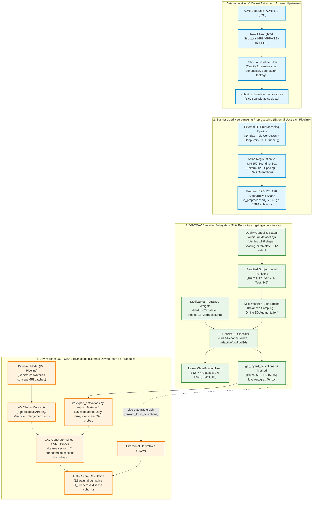
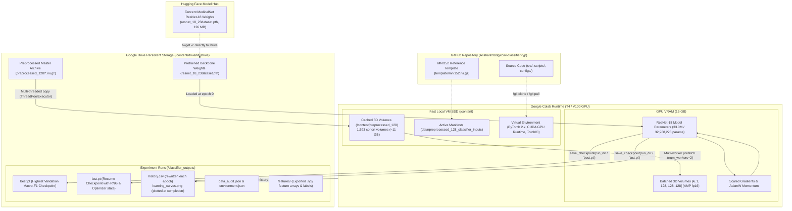
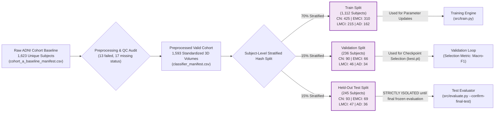

# System Architecture Diagram

This document illustrates the end-to-end system architecture of the **DG-TCAV 3D MRI Classifier Subsystem**, its integration within the broader DG-TCAV (Diffusion-Generated Testing with Concept Activation Vectors) research framework, and its hardware deployment topology across local workstations, Google Colab GPU runners, and Google Drive storage.

---

## 1. End-to-End System Context Diagram

The classifier serves as the foundational **evaluation backbone** for the DG-TCAV project. It classifies 3D baseline brain MRI scans into four clinical stages: **Cognitive Normal (CN)**, **Early Mild Cognitive Impairment (EMCI)**, **Late Mild Cognitive Impairment (LMCI)**, and **Alzheimer's Disease (AD)**. It also exposes a spatial feature bottleneck at Layer 4 for extracting activations used to construct Concept Activation Vectors (CAVs).

---

## 2. Infrastructure & Deployment Topology

The diagram below visualizes how code, weights, dataset volumes, and training artifacts flow between GitHub, the Google Colab GPU compute environment, and persistent Google Drive storage.

---

## 3. Strict Patient Isolation and Cohort Partition Architecture

To guarantee **zero patient leakage** in clinical validation, all partitioning is performed strictly at the **Subject ID** level before any volumes are read. Exactly one baseline scan per subject is admitted into the scientific study.

