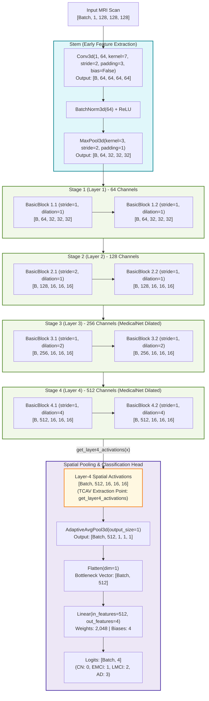
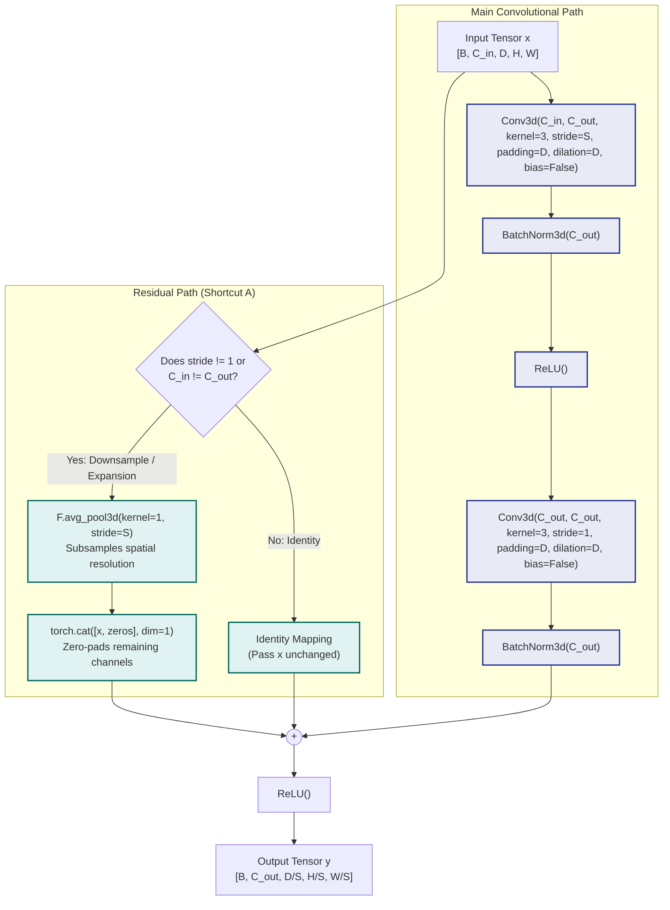
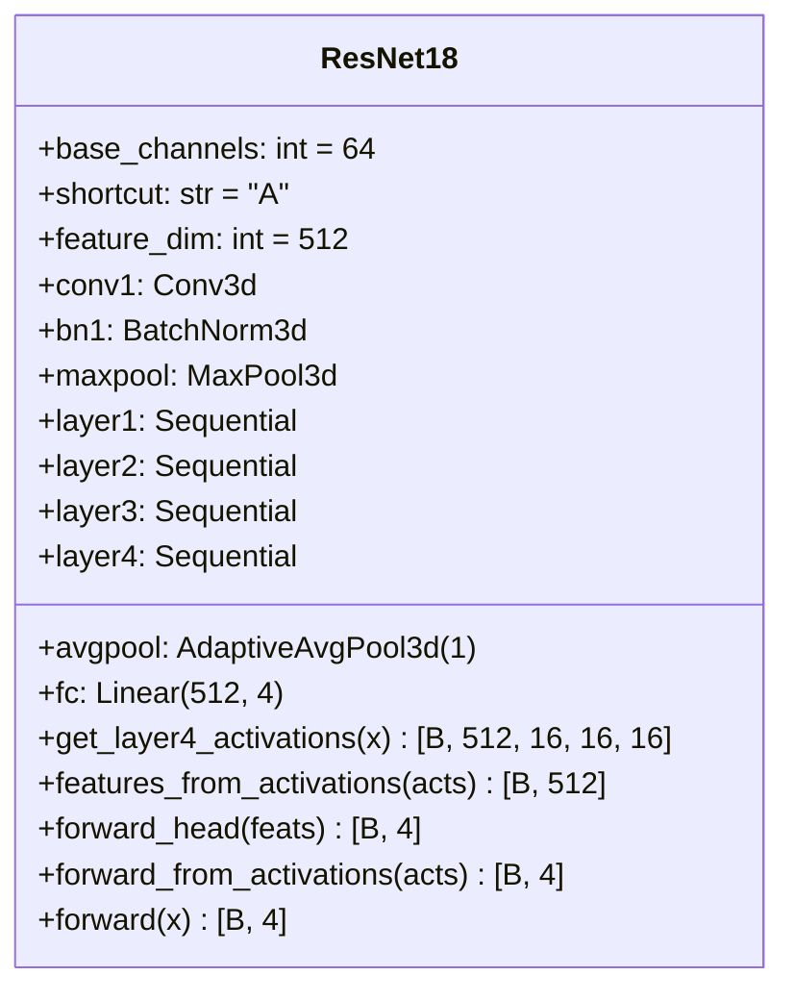

# Model Architecture Diagrams

This document details the primary neural network architecture implemented in [`src/model.py`](file:///e:/Desktop/git_repos/dg-tcav-classifier-fyp/src/model.py):
1. **MedicalNet 3D ResNet-18 Backbone** (Pretrained 3D Residual Network)
2. **Residual BasicBlock Sub-architecture** (Shortcut Type A)
3. **TCAV Concept Extraction Interface** (Layer-4 Activations & Bottleneck Features)

---

## 1. MedicalNet 3D ResNet-18 Architecture

The 3D ResNet-18 is a four-stage convolutional residual network adapted for 3D volumetric medical imaging. In transfer-learning profiles ([`configs/colab_medicalnet_resnet18_128.yaml`](file:///e:/Desktop/git_repos/dg-tcav-classifier-fyp/configs/colab_medicalnet_resnet18_128.yaml)), it loads backbone weights pre-trained across 23 3D medical datasets (Tencent Med3D). It uses `AdaptiveAvgPool3d(1)` to create a compact, spatially invariant 512-dimensional bottleneck.

---

## 2. Residual BasicBlock Sub-Architecture (Shortcut Type A)

Each stage consists of two residual BasicBlocks. When downsampling or increasing channels, MedicalNet uses parameter-free **Shortcut A** (`F.avg_pool3d` + zero padding), keeping the autograd graph clean and memory footprint light.

---

## 3. Layer Specifications & Parameter Count

| Layer / Stage | Submodules | Output Tensor Shape ($128^3$ Input) | Total Parameters |
|:---|:---|:---:|:---:|
| **Stem** | `Conv3d(1, 64, 7, s=2, p=3)` + `BN` + `MaxPool3d(3, s=2)` | `[Batch, 64, 32, 32, 32]` | **22,080** |
| **Stage 1 (Layer 1)** | 2 × BasicBlock (64 ch, stride=1, dilation=1) | `[Batch, 64, 32, 32, 32]` | **442,880** |
| **Stage 2 (Layer 2)** | 2 × BasicBlock (128 ch, stride=2, dilation=1) | `[Batch, 128, 16, 16, 16]` | **1,549,312** |
| **Stage 3 (Layer 3)** | 2 × BasicBlock (256 ch, stride=1, dilation=2) | `[Batch, 256, 16, 16, 16]` | **6,195,200** |
| **Stage 4 (Layer 4)** | 2 × BasicBlock (512 ch, stride=1, dilation=4) | `[Batch, 512, 16, 16, 16]` | **24,776,704** |
| **Global Pooling** | `AdaptiveAvgPool3d(1)` + `Flatten(1)` | `[Batch, 512]` | **0** |
| **Classification Head** | `Linear(512, 4)` | `[Batch, 4]` | **2,052** |
| **Total ResNet-18** | Full model with Shortcut Type A | `[Batch, 4]` | **32,988,228** |

---

## 4. TCAV Concept Extraction Interface

To support downstream Concept Activation Vector (CAV) extraction, [`src/model.py`](file:///e:/Desktop/git_repos/dg-tcav-classifier-fyp/src/model.py) exposes direct inspection methods on `ResNet18`:

