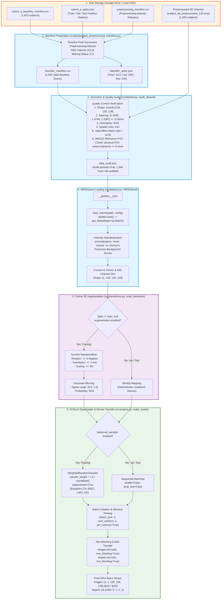
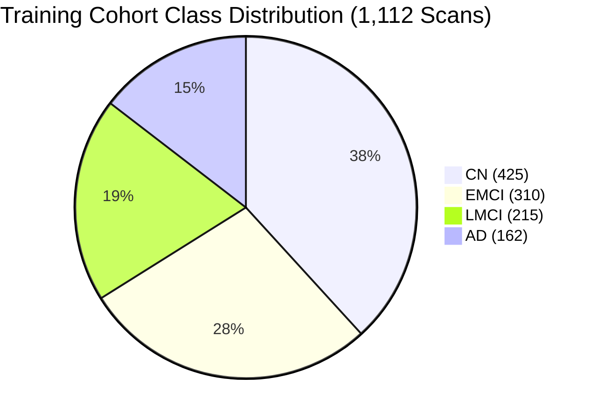

# Data Flow & Preprocessing Pipeline Diagram

This document illustrates the complete end-to-end data transformation pipeline: from raw ADNI NIfTI scan volumes on disk to normalized, augmented PyTorch 5D tensors (`[Batch, 1, 128, 128, 128]`) ready for GPU computation.

---

## 1. End-to-End Data Transformation Flow

---

## 2. Voxel Geometry and Normalization Specifications

| Pipeline Stage | Voxel Dimension | Intensity Range | Channel Layout | Coordinate Space |
|:---|:---|:---|:---|:---|
| **Raw ADNI T1** | Variable ($256\times 256\times 176$) | Raw MR Units ($[0, 2500+]$) | 3D Volume | Native Scanner Space |
| **Preprocessed Scan** | **$128 \times 128 \times 128$** | Standardized Foreground (Zero Background) | 3D Volume | Standardized Grid (RAS, MNI152 FOV length) |
| **Post-Augmentation** | **$128 \times 128 \times 128$** | Standardized | 3D Volume | MNI152 Perturbed ($\pm 5^\circ, \pm 2\text{mm}$) |
| **Model Input Batch** | **$[4, 1, 128, 128, 128]$** | Standardized (fp16/fp32) | 5D Tensor ($B \times C \times D \times H \times W$) | GPU CUDA Memory |

---

## 3. Class Balance & Sampling Mechanics

The ADNI baseline cohort has inherent class imbalance reflecting real-world clinical recruitment:
- **CN (Cognitive Normal):** 425 training scans ($38.2\%$)
- **EMCI (Early MCI):** 310 training scans ($27.9\%$)
- **LMCI (Late MCI):** 215 training scans ($19.3\%$)
- **AD (Alzheimer's Disease):** 162 training scans ($14.6\%$)

To prevent gradient dominance by the majority CN class without artificially weighting loss penalties twice:
- `training.balanced_sampler: true` $\rightarrow$ attaches `WeightedRandomSampler(weights, replacement=True)`.
- `training.weighted_loss: false` $\rightarrow$ uses standard CrossEntropyLoss ($w_c = 1.0$), avoiding double-reweighting.
- Each training epoch samples **1,112 draws with replacement**, yielding approximately equal class representation per epoch.
