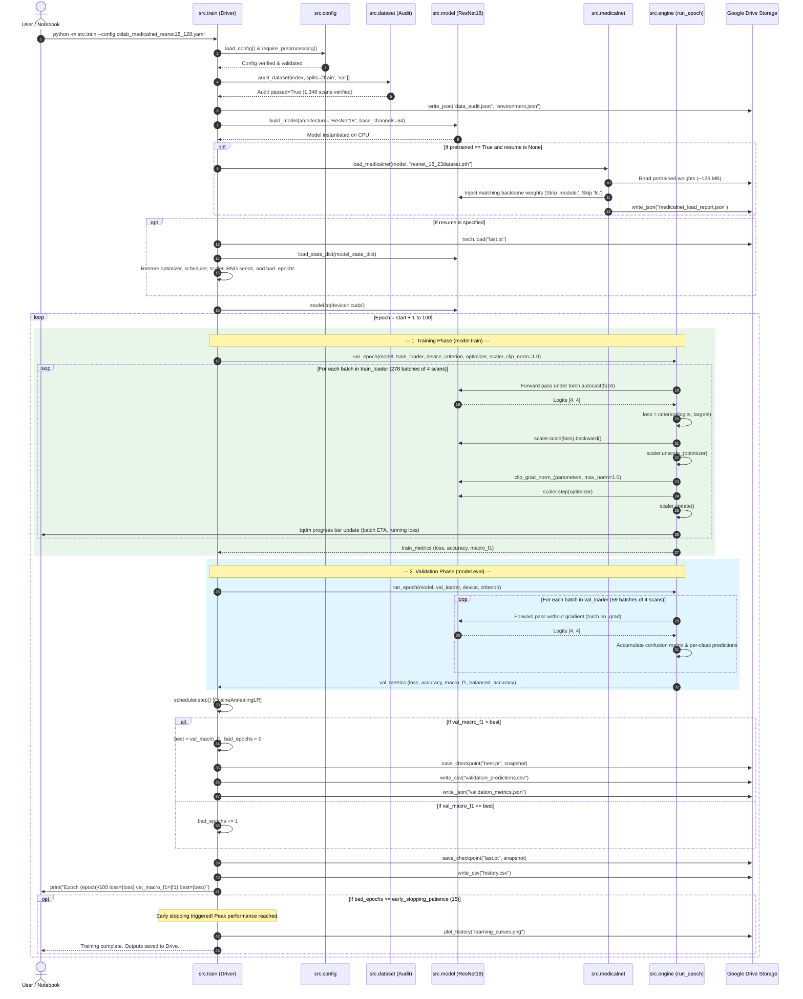
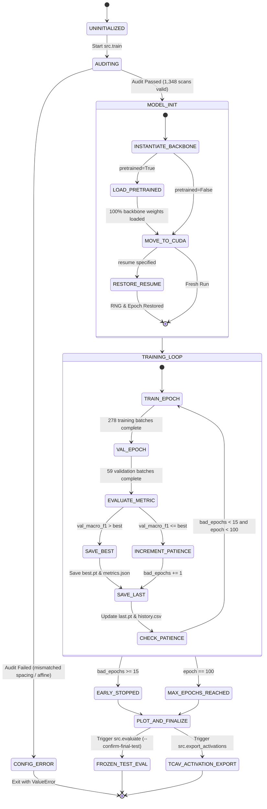

# Runtime & Execution Flow Diagrams

This document illustrates the dynamic runtime behavior, state transitions, and step-by-step sequence of the training, validation, checkpointing, and evaluation lifecycle executed by [`src/train.py`](file:///e:/Desktop/git_repos/dg-tcav-classifier-fyp/src/train.py) and [`src/engine.py`](file:///e:/Desktop/git_repos/dg-tcav-classifier-fyp/src/engine.py).

---

## 1. Complete Training & Validation Sequence Diagram

> [!NOTE] Cohort and Batch Count Alignment
> The numbers depicted below reflect the active production profile (`configs/colab_medicalnet_resnet18_128.yaml`) running on the full preprocessed cohort:
> - **Audited Volumes:** 1,112 train + 236 validation = **1,348 scans** (matches live startup audit log)
> - **Training Batches:** $\lceil 1,112 / 4 \rceil = \mathbf{278\text{ batches}}$ per epoch at `batch_size: 4` (matches live tqdm progress bar `278/278`)
> - **Validation Batches:** $\lceil 236 / 4 \rceil = \mathbf{59\text{ batches}}$ per epoch at `batch_size: 4`
> 
> *(Note on alternative runs: The historical exploratory Kaggle run used `batch_size: 2`, and an early intermediate local subset contained only 535 train scans [134 batches]. The active Colab training run executes on the full verified 1,112-train / 236-val cohort).*

---

## 2. Training Run Lifecycle State Diagram

