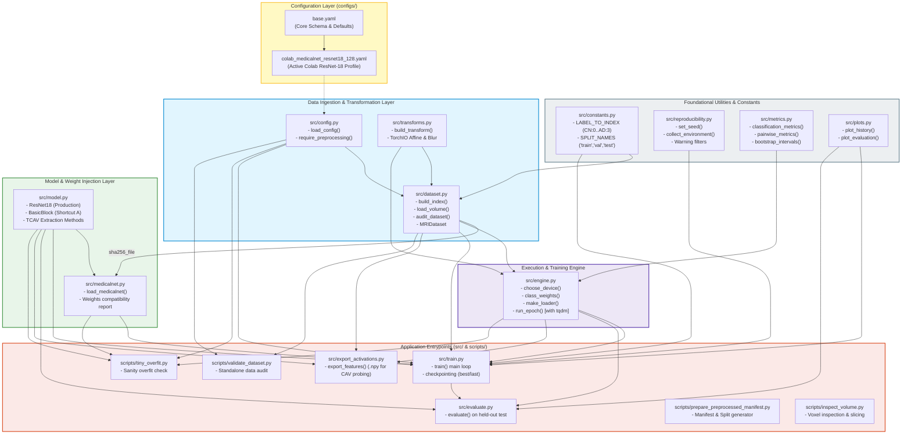

# Module Dependencies & File Connection Graph

This document details the modular organization of the repository, illustrating how all Python source modules (`src/`), runnable CLI scripts (`scripts/`), configuration files (`configs/`), and test suites (`tests/`) depend on and communicate with each other.

---

## 1. Complete File-by-File Architecture & Dependency Graph

---

## 2. Source Module Responsibility Matrix

| File Path | Primary Responsibilities | Key Exported Functions / Classes |
|:---|:---|:---|
| [`src/constants.py`](file:///e:/Desktop/git_repos/dg-tcav-classifier-fyp/src/constants.py) | Immutable project constants, label mappings, and split identifiers | `LABEL_TO_INDEX`, `SPLIT_NAMES`, `REQUIRED_MANIFEST_COLUMNS` |
| [`src/config.py`](file:///e:/Desktop/git_repos/dg-tcav-classifier-fyp/src/config.py) | Recursive YAML inheritance (`extends`), validation rules, and schema checks | `load_config()`, `require_preprocessing()` |
| [`src/reproducibility.py`](file:///e:/Desktop/git_repos/dg-tcav-classifier-fyp/src/reproducibility.py) | Seed synchronization across Python, NumPy, CUDA; warning filters; hardware fingerprinting | `set_seed()`, `collect_environment()`, `save_environment()` |
| [`src/dataset.py`](file:///e:/Desktop/git_repos/dg-tcav-classifier-fyp/src/dataset.py) | NIfTI file verification, spatial affine auditing, intensity standardization, and PyTorch dataset | `build_index()`, `load_volume()`, `audit_dataset()`, `MRIDataset` |
| [`src/transforms.py`](file:///e:/Desktop/git_repos/dg-tcav-classifier-fyp/src/transforms.py) | Online 3D spatial transformations (TorchIO RandomAffine) and Gaussian blurring | `build_transform()` |
| [`src/model.py`](file:///e:/Desktop/git_repos/dg-tcav-classifier-fyp/src/model.py) | MedicalNet 3D ResNet-18, Shortcut A BasicBlock, and TCAV feature extractor interfaces | `ResNet18`, `BasicBlock`, `build_model()` |
| [`src/medicalnet.py`](file:///e:/Desktop/git_repos/dg-tcav-classifier-fyp/src/medicalnet.py) | MedicalNet Med3D weight loading, key mapping (`module.` stripping), and SHA-256 validation | `load_medicalnet()` |
| [`src/metrics.py`](file:///e:/Desktop/git_repos/dg-tcav-classifier-fyp/src/metrics.py) | Macro-F1, balanced accuracy, confusion matrices, bootstrap 95% confidence intervals | `classification_metrics()`, `pairwise_metrics()`, `bootstrap_intervals()` |
| [`src/engine.py`](file:///e:/Desktop/git_repos/dg-tcav-classifier-fyp/src/engine.py) | PyTorch DataLoader construction, class balancing samplers, AMP autocast, and training loop | `choose_device()`, `class_weights()`, `make_loader()`, `run_epoch()` |
| [`src/plots.py`](file:///e:/Desktop/git_repos/dg-tcav-classifier-fyp/src/plots.py) | Renders learning curve plots (`learning_curves.png`), ROC curves, and confusion matrix figures | `plot_history()`, `plot_evaluation()` |
| [`src/train.py`](file:///e:/Desktop/git_repos/dg-tcav-classifier-fyp/src/train.py) | Main driver for full training, early stopping, history logging (`history.csv`), and checkpointing (`best.pt`, `last.pt`) | `train()`, `save_checkpoint()`, `write_history_csv()`, `main()` |
| [`src/evaluate.py`](file:///e:/Desktop/git_repos/dg-tcav-classifier-fyp/src/evaluate.py) | Standalone evaluation of frozen checkpoints on held-out test data | `evaluate()`, `main()` |
| [`src/export_activations.py`](file:///e:/Desktop/git_repos/dg-tcav-classifier-fyp/src/export_activations.py) | Exports Layer 4 pooled features (`pooled_features.npy`) and optional spatial arrays (`.npy`) without gradients for offline CAV fitting | `export_features()`, `main()` |
| [`scripts/tiny_overfit.py`](file:///e:/Desktop/git_repos/dg-tcav-classifier-fyp/scripts/tiny_overfit.py) | Fast memorization sanity test on an 8-subject balanced subset | `main()` |
| [`scripts/validate_dataset.py`](file:///e:/Desktop/git_repos/dg-tcav-classifier-fyp/scripts/validate_dataset.py) | CLI utility to verify dataset geometry and affine alignment before training | `main()` |
| [`scripts/prepare_preprocessed_manifest.py`](file:///e:/Desktop/git_repos/dg-tcav-classifier-fyp/scripts/prepare_preprocessed_manifest.py) | Compiles raw cohort metadata and preprocessing statuses into final classifier manifests | `main()` |
