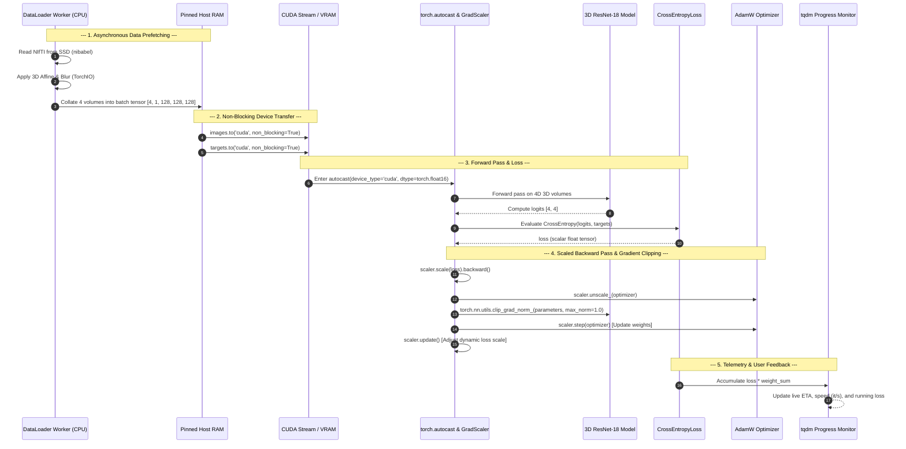
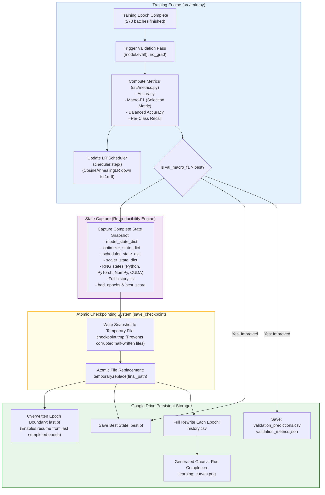

# Component Interaction & Hardware Pipeline Diagram

This document illustrates the internal component interactions that take place across CPU threads, GPU CUDA streams, and persistent disk storage during a single training batch step and across epoch boundaries.

---

## 1. Single Training Step Component Interaction Diagram

---

## 2. Epoch Boundary Component Interaction & Checkpoint Safety

At the conclusion of each epoch, multiple monitoring, scheduling, and storage components coordinate to ensure that model weights, metrics, and random generator states are persisted via temporary-file replacement to minimize checkpoint corruption across epoch boundaries if Google Colab disconnects.

