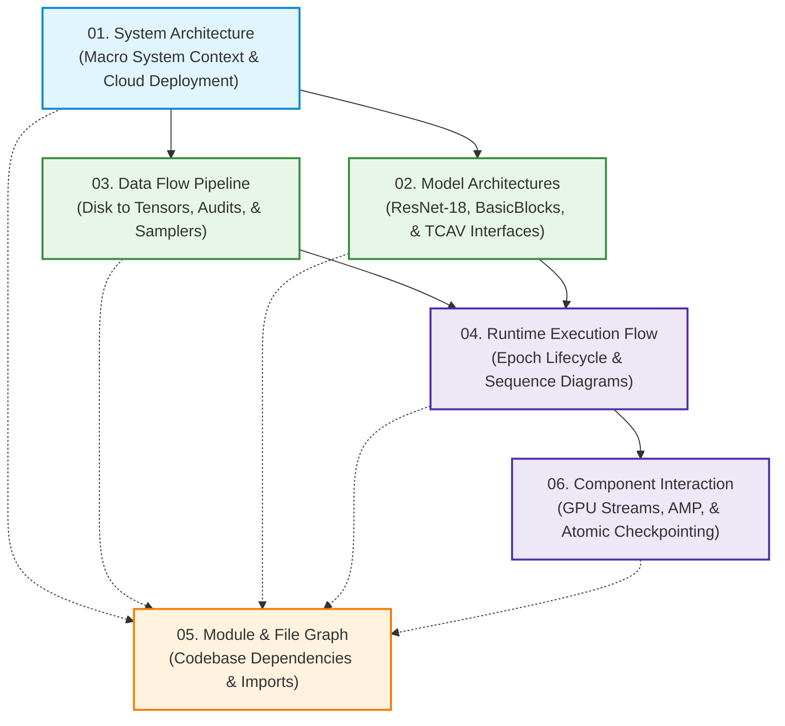

# DG-TCAV 3D MRI Classifier — Architectural Diagrams Master Index

This directory contains the complete technical architecture and visual documentation for the **DG-TCAV 3D MRI Classifier Subsystem**. Each document provides production-grade Mermaid diagrams, tensor dimension mappings, module dependency graphs, and hardware topology specifications.

---

## Document Index & Directory Map

| # | Document Title | Primary Diagrams & Specifications | Direct Link |
|:---:|:---|:---|:---:|
| **01** | **System Architecture** | End-to-end DG-TCAV pipeline, ADNI cohort acquisition, hardware deployment topology (Local, Colab, Google Drive), and strict patient-level partition isolation. | [View Document](file:///e:/Desktop/git_repos/dg-tcav-classifier-fyp/architectural_diagrams/01_system_architecture.md) |
| **02** | **Model Architectures** | Layer-by-layer 3D tensor geometry of Pretrained MedicalNet ResNet-18, Shortcut Type A BasicBlock, layer specifications, parameter counts, and TCAV activation interfaces. | [View Document](file:///e:/Desktop/git_repos/dg-tcav-classifier-fyp/architectural_diagrams/02_model_architectures.md) |
| **03** | **Data Flow & Preprocessing** | Flow from raw NIfTI files to normalized PyTorch 5D tensors (`[4, 1, 128, 128, 128]`), manifest generation, quality audit rules, TorchIO augmentations, and balanced sampling mechanics. | [View Document](file:///e:/Desktop/git_repos/dg-tcav-classifier-fyp/architectural_diagrams/03_data_flow_pipeline.md) |
| **04** | **Runtime Execution Flow** | Sequence diagram of the training/validation loop, state machine lifecycle, mixed-precision AMP forward/backward passes, early stopping, and checkpoint management. | [View Document](file:///e:/Desktop/git_repos/dg-tcav-classifier-fyp/architectural_diagrams/04_runtime_execution_flow.md) |
| **05** | **Module & Dependency Graph** | Complete file-by-file module connection graph connecting `configs/`, `src/`, `scripts/`, and `tests/`, along with a comprehensive responsibility matrix. | [View Document](file:///e:/Desktop/git_repos/dg-tcav-classifier-fyp/architectural_diagrams/05_file_dependency_and_module_graph.md) |
| **06** | **Component Interaction** | Fine-grained interaction diagram between CPU data workers, pinned RAM, CUDA streams, GradScaler, optimizer, progress monitor, and atomic checkpointing. | [View Document](file:///e:/Desktop/git_repos/dg-tcav-classifier-fyp/architectural_diagrams/06_component_interaction.md) |

---

## Architectural Hierarchy Overview

---

## Key Technical Specifications Summary

- **Task:** 4-Class Baseline T1 Structural Brain MRI Classification (`CN: 0`, `EMCI: 1`, `LMCI: 2`, `AD: 3`).
- **Input Dimension:** Full **$128 \times 128 \times 128$** standardized voxel grid (Zero spatial cropping; verifies FOV extent, voxel spacing, and RAS orientation matching MNI152 reference template).
- **Core Backbone:** **MedicalNet 3D ResNet-18** (`base_channels: 64`, `shortcut: A`), pre-trained on 23 medical imaging datasets (Med3D).
- **Spatial Bottleneck:** `AdaptiveAvgPool3d(1)` producing a **512-dimensional feature vector**.
- **TCAV Extraction Point:** Spatial activations after Layer 4 (`[Batch, 512, 16, 16, 16]`).
- **Optimization:** AdamW (`lr: 1e-4`, `weight_decay: 1e-4`), `CosineAnnealingLR` (`min_lr: 1e-6`), PyTorch AMP (fp16), and gradient norm clipping (`1.0`).
- **Class Balancing:** `WeightedRandomSampler` sampling with replacement without double-reweighting the loss.
- **Patient Isolation:** Subject-level hash partitioning (Train: 1,112 | Val: 236 | Test: 245) with strictly one baseline scan per subject.
